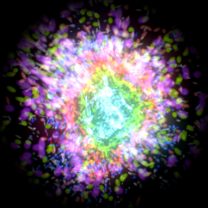
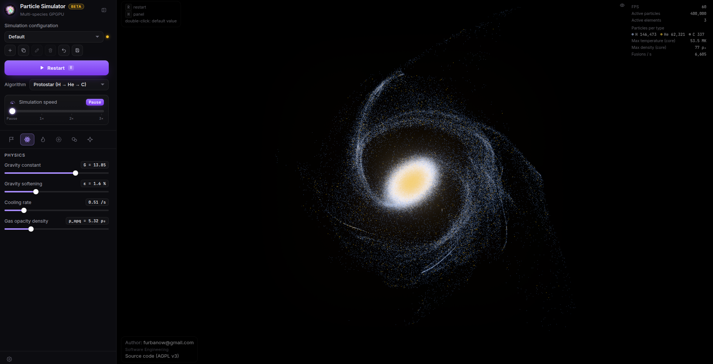

# Particle Simulator — Gravity & Supernova



Multi-species GPGPU particle simulator running in the browser (TypeScript, Three.js, WebGL2).

**Live demo: https://furbanow.github.io/particle-simulator/**

- **Physics**: from 1,000 to N particles; their positions and velocities are stored in floating-point textures. Gravity is computed on a mipmapped *cloud-in-cell* density field, with relative pressure and viscosity.
- **Elements**: the first 10 elements of the periodic table (hydrogen → neon), with their real atomic masses (in u), sizes proportional to atomic radii, and CPK colors. They stratify according to their density. A dedicated bar at the top of the page lets you activate 1 to 10 of them and edit their properties on a bar chart, one property at a time (population share, atomic mass, size, color as hue · saturation · lightness), with default values and random draws. The selected element also has all its sliders on the right, with its name and symbol. Element configurations are saved in the browser: new, duplicate, rename, delete, load.
- **Simulation configurations**: above the **Restart** button, the entire simulation can be saved in the browser (algorithm, parameters, element definitions, visual effects, speed): new, duplicate, rename, delete, load. Loading a configuration restarts the simulation; the last one selected is restored when the page opens.
- **Static drawings**: a **Drawing** tab places invisible masses that never move: **attractors** (like dark matter) pull the matter, **repellers** push it away. Both kinds can be active at once, each with its own mask, strength and softening, drawn with the mouse (brush, eraser, filled or hollow ellipses and rectangles; visible while drawing, it fades a second later), imported from an image (fitted to the screen, bright parts dense) or written as a multi-line text (font, size, bold, italic, line height, alignment). Buttons clear all the drawings or only the selected kind; it applies to every algorithm.
- **Mouse toolbar**: a discreet, see-through toolbar at the top center of the animation picks what the mouse does, as in a paint program: a **point force** (held under the pointer while the left button is pressed; right click gives the opposite force), the brush, the eraser or a shape (click and drag; Shift for a circle or a square, Alt from the center); clicking the active tool again drops it. A long press (or a right click) on a tool unfolds its variants: attraction, repulsion or **vortex** for the point force, the attractor or repeller brush, filled or hollow ellipses and rectangles. Its other buttons set the brush size and density and the outline thickness (in small popovers, or with the mouse wheel), keep the drawings shown and clear them.
- **Supernovae**: when the densest zone exceeds the chosen threshold, it explodes (radial ejection), then a 1/r shock wave sweeps through the other clusters.
- **Rendering**: half-float HDR pipeline, chaining a colored nebula, a gravitational lens with chromatic separation, bloom, vignette, grain and Khronos Neutral tone mapping.



## Author

Filip Urbanowicz — furbanow@gmail.com

## License

Copyright © 2026 Filip Urbanowicz.

Particle Simulator is free software, distributed under the **[GNU Affero General Public License v3.0 or later](LICENSE)** (`AGPL-3.0-or-later`). You may use, study, modify and redistribute it, including commercially, as long as every distributed or network-served modified version also provides its complete source code under the same license.

**Commercial license.** If the AGPL does not suit your use (for example, integration into a closed-source product), a commercial license is available. Contact furbanow@gmail.com.

Third-party components and their licenses: [THIRD_PARTY_LICENSES.md](THIRD_PARTY_LICENSES.md).

## Contributing

Contributions are welcome: see [CONTRIBUTING.md](CONTRIBUTING.md) and the [Code of Conduct](CODE_OF_CONDUCT.md). Contributors sign a [CLA](CLA.md) once (they keep their copyright), which allows the project to be offered under both the AGPL and a commercial license.

## Prerequisites

- Node.js ≥ 18 and npm
- A WebGL2 browser supporting `EXT_color_buffer_float` (recent Chrome, Firefox or Edge)

## Getting started

```sh
make install   # npm dependencies
make dev       # development server at http://localhost:5173
```

| Command          | Effect                                             |
|------------------|----------------------------------------------------|
| `make dev`       | development server with hot reload                 |
| `make build`     | type checking, then build in `dist/`               |
| `make preview`   | serves the production build                        |
| `make typecheck` | TypeScript type checking                           |
| `make test`      | unit tests (Vitest)                                |
| `make check`     | types + tests                                      |
| `make clean`     | removes `dist/`                                    |

## Shortcuts

- **R**: restart the simulation
- **H**: hide or show the panel
- **V / F / B / E / U**: no tool, point force (F again: the next force type), brush, eraser, shapes (U again: the next shape)
- **X**: swap attraction and repulsion (of the point force, or of the drawing tools)
- **[ / ]**: smaller / larger brush (with Shift: its density)
- **Double-click on a slider or a distribution bar**: reset to the default value

## Structure

```
index.html            markup of the control panel and the element bar
src/
  main.ts             assembly: renderer, simulation, rendering, UI, 60 FPS loop
  config.ts           physical and visual constants
  species.ts          species, logarithmic mass scale, random draws
  population.ts       distribution of particles according to population weights
  elementMetrics.ts   editable properties of an element (position 0..1, rounding, defaults, draws)
  elementConfigs.ts   saved element configurations (localStorage)
  simulationConfigs.ts  saved whole-simulation configurations (localStorage)
  visualEffects.ts    visual effects common to all algorithms (sliders of the Visual effects tab)
  drawing.ts          settings of the static drawings (Drawing tab); drawingMask.ts: image fitting, text wrapping, shape frames
  mouseTools.ts       mouse tools, shapes, toolbar shortcuts and point force gains (ui/toolbar.ts builds the toolbar)
  displaySettings.ts  per-browser settings (language, FPS cap, particle limit, overlays)
  benchmark/          GPU benchmark: frame timing (runner.ts) and particle limit search (estimate.ts)
  simulation/         GPGPU (Simulation), density field, cluster detection, shock wave, drawing field
  render/             particle layer, nebula layer, post-processing
  shaders/            GLSL sources (constants injected via #define)
  ui/                 panel (icon tabs, sliders documented on hover), overlaid statistics and element bar (chart per property, editor)
  styles/             CSS split by component
tests/                Vitest tests of the pure functions
```
